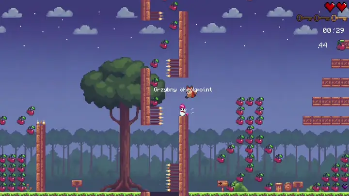
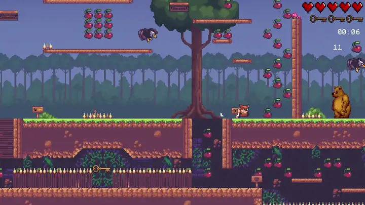
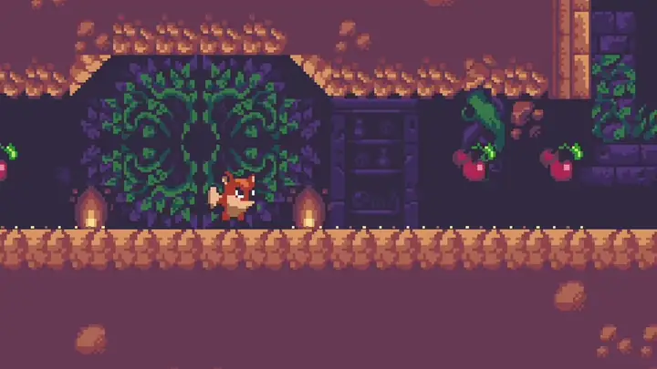
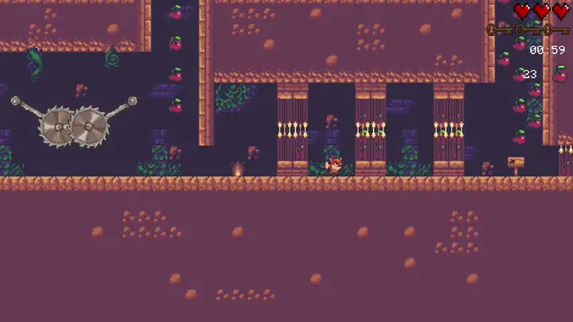
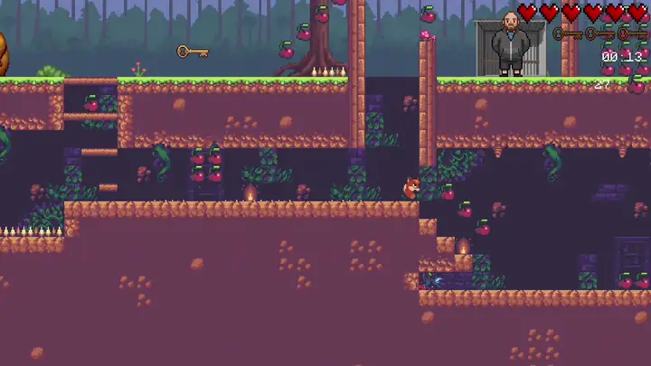
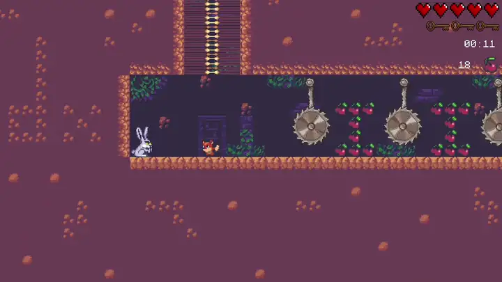
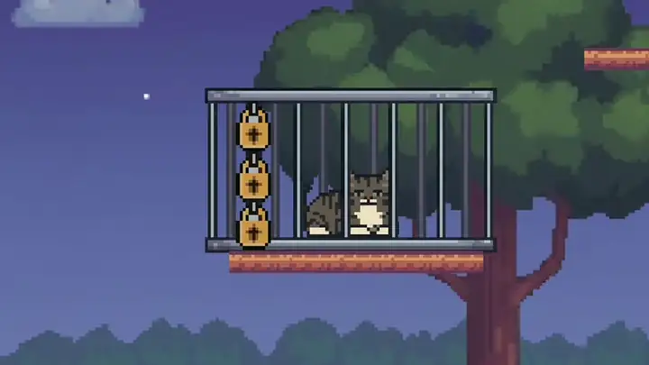
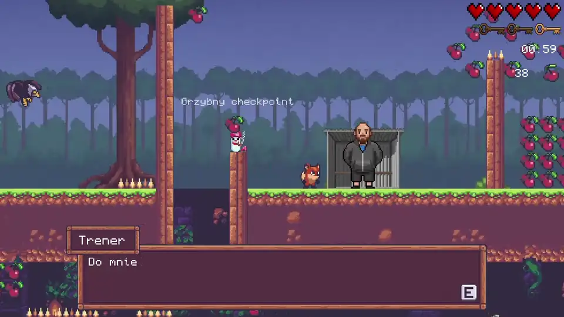

# 🦊 Czy ktoś widział Gabrysia? — platformówka 2D w Unity

> 🥉 **3. miejsce w uczelnianym konkursie na grę** — wszystkie zespoły z roku tworzyły własną platformówkę 2D.

*Czy ktoś widział Gabrysia?* to platformówka 2D, w której lisek przechodzi leśny poziom pełen pułapek, przeciwników i ukrytych sekretów. Szuka kluczy, żeby uwolnić kota Gabrysia.

**Skąd nazwa?** Gabryś to kot, nieoficjalna maskotka Wydziału ETI, który na co dzień spaceruje po korytarzach wydziału. W grze zaginął i trzeba go odnaleźć. Gra ma też sporo innych nawiązań do życia na uczelni, które docenią studenci wydziału.

Projekt zrobiony w dwuosobowym zespole w **Unity 6 (C#, URP 2D)**.

<p align="center">
  
</p>

## 🎬 Zwiastun

https://github.com/user-attachments/assets/cf0fef39-fd9d-4ef7-abcb-5076079ffe32

| Przeciwnicy | Ucieczka przed kolcami |
|---|---|
|  |  |
| **Spadające pułapki** | **Piły** |
|  |  |
| **Sekretny pokój** | **Gabryś czeka na ratunek** |
|  |  |

**Dialogi z NPC**

<p align="center">
  
</p>

## ✨ Co jest w grze

**Ruch postaci**
- bieg, skok i **wall slide / wall jump** (odbicie od ściany z własną fizyką i blokadą sterowania na czas skoku)
- wykrywanie ziemi i ścian raycastami, cooldown skoku
- cząsteczki przy skoku, wall jumpie i lądowaniu, **trzęsienie kamery** zależne od prędkości upadku

**Przeciwnicy i pułapki**
- trzech przeciwników z osobnym AI, dziedziczących po wspólnej klasie `EnemyController`: **niedźwiedź** goni gracza, **szczur** patroluje, jest też **orzeł**
- przeciwnika pokonuje się skokiem na głowę (odbicie od wroga)
- piły na ramieniu, kolce, wysuwane długie kolce, spadające pułapki, rozpadające się platformy

**Poziom i rozgrywka**
- checkpointy, system żyć (serca), monety, klucze potrzebne do ukończenia poziomu
- ruchome platformy (po waypointach) i platformy generowane
- **sekretne pokoje i ukryte miejsca** porozrzucane po poziomie oraz sekretny poziom dla najbardziej dociekliwych (nie zdradzamy, gdzie są 🤫)
- NPC z **systemem dialogów** (efekt pisania, rozmowy wielowątkowe)
- paralaksa tła, kamera podążająca za graczem

**UI i audio**
- menu główne, pauza, opcje (jakość grafiki, głośność), ekran wygranej i Game Over
- licznik czasu, punktów i pokonanych przeciwników, zapisywany najlepszy wynik
- muzyka i efekty dźwiękowe przez Audio Mixer

## 🎮 Sterowanie

| Akcja | Klawisz |
|---|---|
| Ruch | `A` / `D` lub `←` / `→` |
| Skok / wall jump | `Spacja` lub lewy przycisk myszy |
| Rozmowa z NPC / dalej w dialogu | `E` |
| Pauza | `Esc` |

## 🚀 Uruchomienie

1. Zainstaluj **Unity 6000.0.38f1** (przez Unity Hub).
2. Sklonuj repozytorium:
   ```bash
   git clone https://github.com/Grupa-113/Czy-ktos-widzial-Gabrysia.git
   ```
3. W Unity Hub kliknij **Add → Add project from disk** i wskaż folder repozytorium.
4. Otwórz scenę `Assets/Scenes/MainMenu.unity` i wciśnij **Play**.

## 🗂️ Struktura projektu

```
Assets/
├── Scripts/
│   ├── Controllers/   # gracz, przeciwnicy (Bear, Rat), kamera, audio, NPC
│   ├── Managers/      # GameManager (stany gry, UI, wynik), MainMenu
│   ├── Dialogue/      # system dialogów i NPC
│   ├── Traps/         # piły, kolce, spadające pułapki
│   ├── Platforms/     # ruchome i generowane platformy
│   ├── Effects/       # paralaksa, efekty śmierci, rozpadające się platformy
│   └── Checkpoint/
├── Prefabs/           # gracz, przeciwnicy, pułapki, UI
├── Scenes/            # MainMenu, Level 2
└── Nasza Grafika/     # grafiki zrobione przez nas (NPC, pułapki, UI, tła)
```

## 👥 Autorzy

- **Piotr Matuszyk** — [@Boc7777](https://github.com/Boc7777)
- **Julia Glaubert** — [@xYuusi](https://github.com/xYuusi)

## 🎨 Assety zewnętrzne

Grafiki w folderze `Assets/Nasza Grafika` oraz cały kod w `Assets/Scripts` zrobiliśmy sami. Pozostałe zasoby pochodzą od innych twórców, a prawa do nich należą do ich autorów:

- **[SunnyLand](https://ansimuz.itch.io/)** autorstwa **ansimuz**: otoczenie, gracz i przeciwnicy (CC0 / darmowe)
- **2D Pixel Item Pack** autorstwa Startled Pixels: animacja serduszka
- **[Monocraft](https://github.com/IdreesInc/Monocraft)**: czcionka (SIL Open Font License)

Pełna lista z licencjami jest w [CREDITS.md](CREDITS.md).
